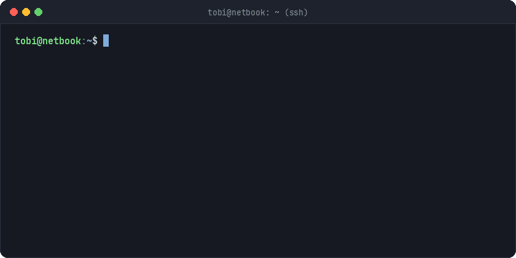

  🌍 <a href="README.md">EN</a> | <b>FR</b>

  <h1>🛠️ Tobi Akinsinmide</h1>
  
<b>Développement Logiciel & Systèmes Linux (BTS SIO) · Amiens, France</b>

  

   

  

    <code>🟢 Homelab : Debian 12 Headless</code> &nbsp;|&nbsp; <code>🔒 Réseau : Maillage Tailscale</code> &nbsp;|&nbsp; <code>⚡ Poste : Kubuntu</code>
  

  

    
    
    
  

---

## ⚡ Profil

> La profondeur système plutôt que la dispersion. Deux ans de BTS SIO, mais le vrai apprentissage s'est fait sur un netbook Debian que j'ai cassé et reconstruit plus de fois que je ne peux compter.

- **Machines :** Kubuntu (poste de travail) · Debian 12 (serveur headless, SSH uniquement)
- **Back-end :** PHP / Symfony, SQL, Python, C#
- **Front-end :** HTML, CSS, JavaScript quand un projet a besoin d'une interface

---

## 🖥️ Home Lab

  

- **Web :** Nginx avec vhosts dédiés, PHP 8.2-FPM via sockets Unix, MariaDB
- **Réseau :** Tailscale, pare-feu UFW en default-deny, autorité de certification interne pour du vrai TLS en local
- **Conteneurs & Outils :** Docker, déploiements via Git, scripts Bash et Python pour les sauvegardes et sondes de santé

---

## 🧰 Stack Technique

**Back-End & Systèmes**

  
  
  
  
  
  

**Infrastructure & Réseau**

  
  
  
  
  
  

**Front-End**

  
  
  

---

## 🎯 Recherche

**Alternance - Cycle Ingénieur (Bac+5) - Septembre 2027**  
À la recherche d'une alternance en back-end, systèmes ou infrastructure. Pour travailler sur de la vraie production et porter des projets de bout en bout.

 

  <i>"Break it, read the logs, fix it, document it."</i>
   
  Anglais (Langue maternelle) · Français (Professionnel) · Yoruba (Langue maternelle)

