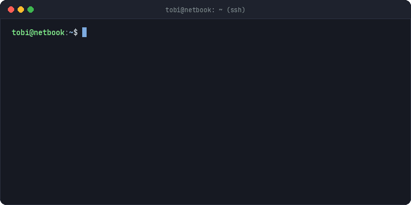

  🌍 <b>EN</b> | <a href="README-fr.md">FR</a>

  <h1>🛠️ Tobi Akinsinmide</h1>
  
<b>Software Engineering & Linux Systems (BTS SIO) · Amiens, France</b>

  

   

  

    <code>🟢 Homelab: Debian 12 Headless</code> &nbsp;|&nbsp; <code>🔒 Network: Tailscale Mesh</code> &nbsp;|&nbsp; <code>⚡ Desktop: Kubuntu</code>
  

  

    
    
    
    
  

---

## ⚡ Profile

> Systems depth over breadth. Two years of BTS SIO, but the real curriculum has been a Debian netbook I broke and rebuilt more times than I can count.

- **Machines:** Kubuntu (workstation) · Debian 12 (headless server, SSH only)
- **Back-end:** PHP / Symfony, SQL, Python, C#
- **Front-end:** HTML, CSS, JavaScript when a project needs an interface

---

## 🖥️ Home Lab

  

- **Web:** Nginx with per-site vhosts, PHP 8.2-FPM over Unix sockets, MariaDB
- **Network:** Tailscale mesh, UFW default-deny, internal CA so local services get real TLS
- **Containers & Tooling:** Docker, Git-based deploys, shell and Python scripts for backups and health checks

---

## 🧰 Tech Stack

**Back-End & Systems**

  
  
  
  
  
  

**Infrastructure & Networking**

  
  
  
  
  
  

**Front-End**

  
  
  

---

## 🎯 Looking For

**Engineering Apprenticeship (Alternance) - September 2027**  
Looking for an apprenticeship in back-end, systems, or infrastructure engineering. Somewhere I can work on real production systems and own things end-to-end.

 

  <i>"Break it, read the logs, fix it, document it."</i>
   
  English (Native) · French (Professional) · Yoruba (Native)

